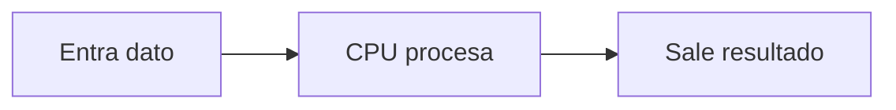
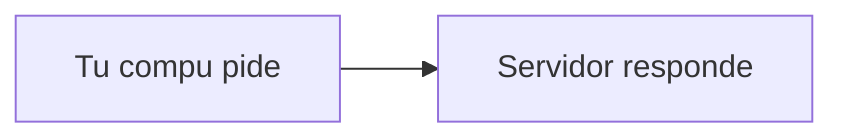

# Módulo 0 - Bases de la Computación

> Para quien nunca ha programado. Sin palabras raras. Si algo suena técnico, lo explicamos con un ejemplo de la vida real.

## Cómo usar este módulo

Todo el módulo usa 3 técnicas probadas para aprender. Son medibles: siempre sabrás tu puntaje.

1. **Fricción antes que teoría.** Cada sección abre con un reto que intentas por escrito antes de leer la explicación. Vale 1 punto por intentarlo, aunque falles.
2. **Recuerda sin mirar.** El lector tapa y demuestra en voz alta o haciéndolo. Vale 2 puntos si sale completo.
3. **Repite espaciado.** Vuelve en 1, 3 y 7 días solo a lo que fallaste.

Cada sección sigue el mismo orden: reto, teoría, casos borde, correcto contra incorrecto, trampa común, preguntas para pensar, resumen y medición de 3 puntos. Anota todo en [NOTAS.md](./NOTAS.md): intentos, errores y correcciones. Sin notas no hay puntos.

Tus puntajes son solo para ti, en tu diario local. Este repo es una guía, no un examen: nadie recoge tu progreso.

> [!TIP]
> Regla de avance: no pases al Módulo 1 hasta sacar 8 de 10 en el repaso final (punto 0.9). Si sacas menos, el mismo 0.9 te dice qué repetir y cuándo.

## Índice

- [Cómo usar este módulo](#cómo-usar-este-módulo)
- [0.1 La computadora es como una cocina](#01-la-computadora-es-como-una-cocina)
- [0.2 Todo son ceros y unos](#02-todo-son-ceros-y-unos)
- [0.3 Archivos y carpetas](#03-archivos-y-carpetas)
- [0.4 La terminal no muerde](#04-la-terminal-no-muerde)
- [0.5 Internet en una frase](#05-internet-en-una-frase)
- [0.6 Cómo vamos a aprender](#06-cómo-vamos-a-aprender)
- [0.7 Palabras que verás mucho](#07-palabras-que-verás-mucho)
- [0.8 Dudas comunes](#08-dudas-comunes)
- [0.9 Repaso final medible](#09-repaso-final-medible)
- [Para profundizar](#para-profundizar)

## 0.1 La computadora es como una cocina

### Reto rápido

Sin leer más abajo: se va la luz mientras escribes un documento sin guardar. ¿Qué se pierde y por qué? Escríbelo en `NOTAS.md` en una frase. La teoría te dirá si acertaste.

Todo lo que hace tu compu sigue el mismo ciclo: **entra algo, se procesa y sale algo**.



En palabras: entra un dato, la CPU lo procesa y sale un resultado.

Ejemplo: presionas `A` (entra), la CPU decide qué hacer (procesa) y la letra aparece en pantalla (sale). Programar es escribir las reglas del paso del medio.

Imagina la cocina:

- **CPU:** el chef que hace el trabajo paso a paso.
- **RAM:** la mesa donde pones lo que usas ahora mismo. Se vacía al apagar.
- **Disco:** la alacena donde guardas todo para después. Sobrevive al apagado.
- **Software:** las recetas que el chef sigue. Sin recetas, la cocina no produce nada.
- **Sistema operativo:** el jefe de cocina que decide quién usa qué. Ejemplos: Windows, macOS, Linux.

### Casos borde

¿RAM llena? La compu se pone lenta o cierra cosas: valida avisando "memoria llena" en vez de romperse. ¿Disco lleno? No puede guardar: el programa serio avisa "sin espacio" en vez de fingir que guardó. Los buenos programas desconfían de los recursos, igual que tú desconfiarás de los datos en el Módulo 1.

### Correcto contra incorrecto

- ✅ Bien: "Guardé el documento en el disco, así que sigue ahí mañana".
- ❌ Mal: "Lo dejé abierto en la pantalla, así que ya está guardado". Lo abierto vive en la RAM y se pierde al apagar si no lo guardas.

### Ojo con esto

Creer que abierto es lo mismo que guardado. Es el error silencioso más caro: horas de trabajo perdidas por no distinguir la mesa de la alacena.

### Investiga

Abre la información de tu compu (en macOS: menú manzana, Acerca de esta Mac; en Windows: Configuración, Sistema, Acerca de) y anota en `NOTAS.md`: modelo de CPU, memoria (RAM), espacio libre en disco, sistema operativo y versión. (Las unidades como GB las verás en el punto 0.2.) Luego clasifica 3 programas que uses a diario: ¿cuáles son sistema operativo y cuáles son aplicaciones? Anota también en qué falló tu reto inicial, si falló.

### Para pensar

1. Si se va la luz mientras escribes sin guardar, ¿qué parte de la cocina perdiste: la mesa o la alacena?
2. ¿Por qué un chef rapidísimo no sirve de nada sin recetas?

### En una frase

La CPU procesa, la RAM sostiene lo de ahora, el disco guarda lo de después y el software dice cómo.

### Mide tu avance

Reto intentado por escrito antes de leer (1 punto). Luego tapa la lista y explica CPU, RAM, disco y ciclo con un ejemplo (2 puntos). Total 3 puntos.

## 0.2 Todo son ceros y unos

### Reto rápido

Sin leer la tabla: ¿cuántos mensajes de "hola" caben en el espacio que ocupa una foto? Escribe un número en `NOTAS.md` antes de seguir. Vas a fallar por mucho, y ese error es la lección.

La compu solo entiende prendido y apagado, como un foco:

- **Bit:** un foquito (`1` es prendido, `0` es apagado).
- **Byte:** 8 foquitos juntos. Guarda 1 letra.

```text
Bits: 1 0 1 0 0 0 0 1 = 1 byte = la letra "A"
```

Python traduce esto por ti. Tú escribes `A` y la compu guarda `01000001`.

### Tamaños KB, MB y GB

Es solo contar bytes juntos, como contar monedas:

| Unidad | Equivale a | Ejemplo |
| --- | --- | --- |
| Byte | 1 letra | `A` |
| KB | 1.000 bytes | Un párrafo |
| MB | 1.000 KB | Una foto |
| GB | 1.000 MB | Un video corto |

Quédate con una idea: mientras más grande el archivo, más bytes ocupa.

### El mismo truco para todo

- **Texto:** cada letra tiene su código. `A` es `01000001`, `B` es `01000010`.
- **Números:** también son foquitos. Por eso `"5"` como texto no es igual a `5` para sumar. Python te deja convertirlos.
- **Fotos:** millones de puntitos de colores. Más puntitos es foto más pesada.
- **Verdadero o falso:** 1 foquito. `1` es sí, `0` es no. Así nacen los booleanos.

### Casos borde

Archivo de 0 bytes: existe pero pesa nada, ¿tu programa lo trataría como error o como válido? Nombre con emoji: cada emoji ocupa varios bytes, así que "hola 😀" pesa más del doble que "hola". Lo raro también ocupa espacio y hay que contarlo.

### Correcto contra incorrecto

- ✅ Bien: `"5"` es texto para mostrar, `5` es número para calcular.
- ❌ Mal: renombrar `foto.jpg` a `foto.txt` esperando que siga siendo foto. La extensión le dice a la compu cómo tratar el archivo.

### Ojo con esto

Confundir MB con Mb. Cuando el internet dice "100 megas", habla de megabits (velocidad), no de megabytes (tamaño). Tu archivo de 100 MB no baja en un segundo con 100 Mb: necesita 8 segundos. Misma letra, mundos distintos.

### Investiga

Elige 3 archivos tuyos (un texto, una foto y un video o audio), mira su tamaño real y anota en `NOTAS.md` cada nombre con su tamaño en KB, MB o GB. Ordénalos de menor a mayor y escribe si el orden coincide con tu número del reto inicial.

### Para pensar

1. ¿Por qué un video de un minuto pesa miles de veces más que este módulo entero en texto?
2. Si todo son ceros y unos, ¿quién decide que `01000001` significa la letra A y no otra cosa?

### En una frase

Todo (letras, números, fotos, sí o no) se guarda como foquitos prendidos o apagados; solo cambia cuántos necesitas.

### Mide tu avance

Reto del número intentado antes de leer (1 punto). Luego tapa la tabla y ordena de menor a mayor Byte, KB, MB y GB (2 puntos). Total 3 puntos.

## 0.3 Archivos y carpetas

### Reto rápido

Sin leer la teoría: dicta por escrito, como por teléfono, dónde está tu foto favorita para que otra persona la encuentre. Anótalo en `NOTAS.md`. Luego verás qué parte de tu dictado era la ruta, la carpeta y la extensión.

Todo lo que guardas vive en archivos dentro de carpetas:

- **Ruta:** la dirección del archivo, como `Documentos/fotos/playa.jpg`.
- **Extensión:** lo que va después del punto (`.jpg`, `.py`, `.txt`). Le dice a la compu qué tipo de cosa es.
- **Regla de oro:** un archivo `.py` es solo texto con instrucciones para Python.

```text
Documentos/
  fotos/
    playa.jpg
  aprender-programacion/
    hola.py
```

### Ruta absoluta y ruta relativa

- **Absoluta:** la dirección completa desde la raíz (la carpeta madre de todas), funciona desde cualquier lugar. Ejemplo: `/Users/tu-nombre/Documentos/fotos/playa.jpg`.
- **Relativa:** la dirección corta desde donde estás parado. Si ya estás en `Documentos`, basta con `fotos/playa.jpg`.

La terminal siempre está parada en alguna carpeta. Por eso el mismo archivo se nombra distinto según desde dónde lo pidas.

### Permisos en una frase

Cada archivo dice quién puede **leerlo** (abrirlo), **escribirlo** (cambiarlo) y **ejecutarlo** (correrlo como programa). Si un día no te deja guardar algo, casi siempre es un permiso, no un archivo roto.

### Casos borde

Archivo sin extensión: la compu no sabe con qué abrirlo y te pregunta. Dos archivos con el mismo nombre en carpetas distintas: no chocan, porque la ruta completa los distingue. Ruta con espacios (`Mis fotos/playa.jpg`): en la terminal hay que entrecomillarla, o la compu la lee como dos cosas. Los espacios son el primer caso borde que te morderá de verdad.

### Correcto contra incorrecto

- ✅ Bien: `presupuesto-2026.py` se entiende sin abrirlo. Los buenos nombres son tu primer hábito profesional.
- ❌ Mal: `x.py`, `final2.py`, `esto.py`. Dentro de una semana ni tú sabrás qué guardan. Y peor: creer que renombrar `.txt` a `.jpg` convierte texto en foto.

### Ojo con esto

Creer que cambiar la extensión convierte el archivo. Solo le cambia la etiqueta: el contenido sigue siendo el mismo y el programa que lo abra se confundirá.

### Investiga

Anota en `NOTAS.md` 3 rutas reales de tu compu usando el explorador de archivos (el de la terminal con `pwd` y `ls` lo aprenderás en el punto 0.4). Marca cuál es absoluta y escribe la versión relativa de al menos una. Para una de ellas, anota su extensión y qué programa la abre. Compara tu dictado del reto con la ruta real: ¿qué te faltó?

### Para pensar

1. Si estás parado en `Documentos` y pides `fotos/playa.jpg`, ¿por qué la compu lo encuentra aunque no le diste la dirección completa?
2. ¿Qué ventaja tiene un nombre de archivo claro frente a uno corto y misterioso cuando el proyecto crece?

### En una frase

Los archivos viven en carpetas con dirección absoluta o relativa, la extensión dice qué son y el nombre debería explicarse solo.

### Mide tu avance

Reto del dictado intentado antes de leer (1 punto). Luego escribe de memoria la ruta absoluta de tu `hola.py` y crea carpeta más archivo sin mirar (2 puntos). Total 3 puntos.

## 0.4 La terminal no muerde

### Reto rápido

Sin haberlo leído: ¿qué crees que hace el comando `ls` solo por su nombre? ¿Y `pwd`? Escríbelo en `NOTAS.md`. Los nombres de la terminal son abreviaturas en inglés: adivinar antes de saber entrena tu intuición.

La terminal es pedirle cosas a la compu con texto en vez de clicks. Con estos comandos haces el 90 por ciento del módulo:

```bash
pwd              # dónde estoy parado
ls               # qué hay aquí
cd python        # entrar a la carpeta python
cd ..            # volver una carpeta atrás
mkdir pruebas    # crear una carpeta
mv viejo nuevo   # renombrar o mover algo
python3 hola.py  # correr tu programa
clear            # limpiar la pantalla
```

Tres ayudas que te ahorran tiempo:

- **Tab** autocompleta nombres. Escribe `cd py` más Tab y la terminal completa `python`.
- **Flecha arriba** repite el comando anterior. Úsala en vez de reescribir.
- **Borrar con `rm`** no tiene papelera. Úsalo solo en carpetas de prueba que tú creaste.

Un flujo completo se ve así:

```bash
mkdir python
cd python
echo "print('hola')" > hola.py
python3 hola.py
```

Dos símbolos nuevos: `>` guarda en un archivo lo que el comando habría mostrado en pantalla, y `~` significa tu carpeta personal (por eso `ls ~` lista tu casa).

### Cómo se llama en tu equipo

| Sistema | La terminal se llama | Cómo abrirla |
| --- | --- | --- |
| macOS | Terminal | `Cmd` más `Espacio`, escribe Terminal |
| Windows | Terminal o PowerShell | Clic derecho en Inicio, Terminal |
| GNU/Linux | Terminal | `Ctrl` más `Alt` más `T` |

Dos avisos para Windows: usa PowerShell o Terminal, no el viejo Símbolo del sistema (`cmd`), porque `ls` y `pwd` solo funcionan en los primeros. Y el comando de Python suele ser `python` en vez de `python3`: comprueba con `python --version` y usa el que responda.

### Casos borde

`cd` a una carpeta que no existe: la terminal no adivina, muestra error y se queda donde estaba. Comando con doble espacio o pegado (`cdpython`): cada espacio y cada letra cuentan. `rm` sobre el archivo equivocado: no hay papelera, por eso solo se usa en pruebas propias. Ante cualquier error, el primer paso profesional es leer el mensaje, no repetir el comando más fuerte.

### Correcto contra incorrecto

- ✅ Bien: `cd python` con espacio, un comando por línea, y leer el mensaje si algo falla.
- ❌ Mal: `cdpython` todo pegado, o `python3 hola` sin la extensión. Y prohibido pegar comandos de internet sin entenderlos: un `rm` ajeno puede borrar de verdad.

### Ojo con esto

Pegar comandos de internet sin entender cada parte. La terminal obedece sin preguntar dos veces: entiende antes de presionar Enter.

### Investiga

Corre `ls ~` (el contenido de tu carpeta personal), anota en `NOTAS.md` 5 carpetas que veas y qué crees que guardan. Prueba Tab con `cd` y la flecha arriba, y anota qué hizo cada una con tus palabras. Registra si tu adivinanza del reto acertó.

### Para pensar

1. Si `ls` no muestra tu archivo, ¿cuáles son las dos causas más probables antes de pensar que se borró?
2. ¿Por qué crees que `rm` no tiene papelera y qué hábito te obliga a tener eso?

### En una frase

La terminal entiende pocos comandos exactos: dime dónde estás, qué hay, entra, crea y corre, y usa Tab antes de adivinar nombres.

### Mide tu avance

Reto de adivinanza intentado antes de leer (1 punto). Luego corre `pwd` y `ls` y explica cada línea de la salida sin mirar (2 puntos). Total 3 puntos.

## 0.5 Internet en una frase

### Reto rápido

Sin ver la tabla: parte esta URL en las piezas que creas que tiene y ponle nombre a cada una: `https://github.com/jyhro/aprender-programacion`. Anótalo en `NOTAS.md`. Luego compara con las 3 partes reales.

Tu compu le pide cosas a otra compu, como pedir comida a domicilio:



En palabras: tu compu pide y el servidor responde.

Los datos viajan muchas veces en formato `JSON`, solo texto ordenado con nombres y valores:

```json
{
  "nombre": "Ana",
  "edad": 20,
  "estudia": true
}
```

Toda dirección web tiene 3 partes:

| Parte | Ejemplo en `https://github.com/jyhro/aprender-programacion` | Para qué sirve |
| --- | --- | --- |
| Protocolo | `https` | Cómo deben hablar las compus |
| Dominio | `github.com` | A qué compu le pides (la agenda que traduce nombres a números se llama DNS) |
| Ruta | `/jyhro/aprender-programacion` | Qué cosa exacta le pides |

### Casos borde

URL mal escrita: el DNS no traduce y el navegador dice que no existe, no es que "se cayó internet". Servidor caído: tu programa debe esperar, reintentar o avisar, nunca quedarse colgado en silencio. JSON con coma colgante: un solo carácter de más rompe todo el formato (ver abajo).

### Correcto contra incorrecto

- ✅ Bien: JSON con comas solo entre elementos, sin coma después del último.
- ❌ Mal: coma colgando al final, que rompe el formato.

```json
{
  "nombre": "Ana",
  "edad": 20
}
```

```json
{
  "nombre": "Ana",
  "edad": 20,
}
```

El segundo falla por esa última coma. Python te avisará con un error: léelo, no lo temas.

### Ojo con esto

Creer que JSON se ejecuta. Es solo datos ordenados: tu programa lo lee, no lo obedece. Confundir datos con instrucciones es la raíz de muchos agujeros de seguridad.

### Investiga

Descompón en `NOTAS.md` 2 direcciones reales (la de este repo en GitHub y una que uses a diario) en protocolo, dominio y ruta. Anota en una frase qué crees que le estás pidiendo al servidor en cada una. Compara con tu partición del reto: ¿cuántas piezas acertaste?

### Para pensar

1. Cuando escribes `github.com`, ¿llegas directo o hay una traducción en el medio? ¿Cuál?
2. Si el servidor responde con JSON, ¿quién tiene que entender ese formato: tú a ojo o tu programa?

### En una frase

Internet es pedir y responder: tu compu pide a una dirección de 3 partes y recibe datos ordenados como JSON.

### Mide tu avance

Reto de partición intentado antes de leer (1 punto). Luego tapa la tabla y explica quién pide, quién responde y qué es el DNS (2 puntos). Total 3 puntos.

## 0.6 Cómo vamos a aprender

### Reto rápido

Sin leer la lista: escribe qué crees que distingue a quien aprende programando de quien solo mira tutoriales. Una frase en `NOTAS.md`. La lista de abajo es la respuesta de quienes ya pasaron por ahí.

Ideas adaptadas de la [guía de Platzi para aprender a programar desde cero](https://platzi.com/blog/como-aprender-a-programar/):

1. Piérdele el miedo a escribir código. Copia, corre, rompe y arregla.
2. Piensa en recetas. Antes de programar, explica los pasos en español.
3. Practica en chiquito. Veinte minutos escribiendo valen más que dos horas mirando.
4. Los errores son normales. Lee el mensaje con calma, te dice dónde mirar.
5. Haz un mini-proyecto tuyo, como tu presupuesto o tu lista de juegos.

### Casos borde

¿Ver la solución del sándwich antes de intentarlo? Eso mata la fricción: el punto 1 de tu medición exige intentarlo primero. ¿Un día sin estudiar por cansancio? Mejor 20 minutos flojos que cero: la racha corta y constante consolida entre sesiones. ¿Solo mirar videos una semana? Existe la ilusión de competencia: entiendes todo viendo y nada haciendo. La prueba es siempre sin mirar.

### Correcto contra incorrecto

- ✅ Bien: 20 minutos escribiendo código con errores propios anotados.
- ❌ Mal: 2 horas de video sin pausar ni tocar el teclado, creyendo que ya se aprendió.

### Ojo con esto

La ilusión de competencia. Entender una explicación no es saber hacerlo: solo cuenta lo que reproduces sin mirar.

### Investiga

Compara tu frase del reto con la lista. Luego escribe en 5 líneas los pasos para preparar un sándwich, tu primer algoritmo, y guárdalo en `NOTAS.md`.

### Para pensar

1. ¿Qué parte de tu última sesión fue mirar y cuál fue hacer? ¿Cómo las equilibras mañana?
2. ¿Qué error reciente te enseñó algo que ya no repites?

### En una frase

Se aprende haciendo en chiquito, rompiendo sin miedo y leyendo los errores como pistas.

### Mide tu avance

Reto de la frase intentado antes de leer (1 punto). Luego escribe los 5 pasos del sándwich sin mirar (2 puntos). Total 3 puntos.

## 0.7 Palabras que verás mucho

### Reto rápido

Sin leer las definiciones: escribe en `NOTAS.md` lo que crees que significa cada uno de estos 7: programa, sintaxis, variable, lista, función, condicional, bucle. Un ejemplo por cada uno si puedes. Luego corrige con tinta de otro color.

- **Programa:** receta que la compu sigue. Ejemplo: `hola.py`.
- **Sintaxis:** reglas de escritura. Si te equivocas, la compu te avisa con un error.
- **Variable:** cajita con nombre donde guardas algo, como `ahorro = 200`.
- **Lista:** varias cajitas en fila, como `["pan", "queso", "jamón"]`.
- **Función:** máquina que hace algo cada vez que la llamas, para no repetir código.
- **Condicional:** si pasa esto, haz esto. Ejemplo: si tienes hambre, come.
- **Bucle:** repite hasta que termine. Ejemplo: mientras haya platos sucios, lava.

### Casos borde

Variable sin valor guardado: usarla antes de asignarla es error en casi todo lenguaje. Nombre que miente (`total` guardando un nombre): funciona, pero engaña al lector. Los bordes también viven en cómo nombras.

### Correcto contra incorrecto

- ✅ Bien: `ahorro = 200` se lee solo.
- ❌ Mal: `x = 200` y una semana después nadie sabe qué era `x`. Adelanto del Módulo 1: los nombres son documentación.

### Ojo con esto

Memorizar definiciones sin ejemplo propio. Si no puedes inventar un ejemplo distinto al del texto, no lo sabes todavía.

### Investiga

Corrige tus 7 definiciones del reto con otro color y anota en `NOTAS.md` cuáles acertaste de entrada y cuáles no. Esas últimas van al repaso del día 3.

### Para pensar

1. ¿Qué diferencia hay entre una variable y un valor escrito directo en el paso?
2. ¿Cuándo conviene una función y cuándo basta con repetir los pasos?

### En una frase

Programar es guardar datos en cajitas y decidir qué hacer con ellos: una vez, con condición o en repetición.

### Mide tu avance

Reto de las 7 definiciones intentado antes de leer (1 punto). Luego tapa y define los 7 en voz alta con ejemplo: 6 a 7 bien valen 2 puntos, 4 a 5 valen 1 punto, menos es 0. Total 3 puntos.

## 0.8 Dudas comunes

**¿Tengo que memorizar el binario?**
No. Solo entiende la idea: todo se guarda como prendido o apagado. Python traduce por ti.

**¿RAM y disco no son lo mismo?**
No. La RAM es la mesa (se vacía al apagar), el disco es la alacena (conserva). Por eso hay que guardar.

**¿Por qué un `.py` es solo texto?**
Porque Python lo lee línea por línea como una receta. La extensión solo le dice a la compu qué programa debe abrirlo.

**La terminal dice "command not found", ¿rompí algo?**
No. Casi siempre es un comando mal escrito o una carpeta distinta a la que crees. Revisa el espacio y corre `pwd`.

**¿JSON es un lenguaje de programación?**
No. Es solo un formato de datos ordenado. Tu programa lo lee, no lo ejecuta.

**¿Necesito internet para programar?**
No para escribir y correr tus programas. Sí para pedir datos a otros, como hace tu compu con los servidores.

**¿MB y Mb son lo mismo?**
No. MB es tamaño (megabytes), Mb es velocidad (megabits). Ojo con la mayúscula cuando contrates o midas internet.

## 0.9 Repaso final medible

Hazlo sin mirar el resto del módulo. Suma tus puntos al final. Todo queda anotado en `NOTAS.md`.

### Práctica 1 - Qué pesa más y dónde vive (2 puntos)

1. Observa: el mensaje `hola` y una selfie de tu compu o celular.
2. Pregunta: ¿cuál ocupa más bytes y dónde vive cada uno, en RAM o en disco?
3. Escribe tu hipótesis antes de medir (1 punto por dejarla escrita).
4. Mide: mira el tamaño de cada archivo (clic derecho, Propiedades; o `ls -l` en la terminal, donde `-l` pide la lista detallada) y anota ambos tamaños más dónde vive cada uno (1 punto por anotación completa).
5. Conclusión en una frase: el texto son poquitos bytes en disco y la foto son millones.

### Práctica 2 - La extensión y la ruta mandan (2 puntos)

Trabaja sobre una copia, nunca sobre el original.

1. Observa: copia `hola.py` como `hola-copia.py` dentro de `python`.
2. Pregunta: ¿qué pasa si le cambio la extensión a `.txt` y la pido con ruta relativa?
3. Escribe tu hipótesis: qué cambiará al abrirla y cuál es su ruta absoluta (1 punto por dejarla escrita).
4. Experimento: entra a la carpeta con `cd`, renombra con `mv hola-copia.py hola-copia.txt` (`mv` significa mover o renombrar) e intenta abrirla.
5. Anota qué cambió, qué siguió igual y la ruta absoluta (1 punto por anotación completa).

### Práctica 3 - Predice la terminal y la web (2 puntos)

1. Abre la terminal dentro de la carpeta del repo.
2. Escribe qué mostrarán `pwd` y `ls` antes de correrlos (1 punto por predicción escrita).
3. Corre ambos comandos y compara línea por línea con tu predicción.
4. Descompón la URL de este repo en GitHub en protocolo, dominio y ruta, sin mirar el punto 0.5 (1 punto por descomposición correcta).

### Auto-test de vocabulario (4 puntos)

Sin mirar el punto 0.7, define los 7 términos con un ejemplo cada uno. De 6 a 7 bien son 4 puntos, de 4 a 5 son 2 puntos, menos es 0.

### Tu puntaje y qué hacer

| Puntaje | Significa | Qué hacer |
| --- | --- | --- |
| 8 a 10 | Listo | Pasa al Módulo 1 |
| 5 a 7 | Casi | Repite mañana solo las prácticas falladas |
| 0 a 4 | Relee | Relee el módulo pasado mañana y repite el repaso |

### Plan de repaso espaciado

- [ ] Día 1: repaso final completo y puntaje anotado en `NOTAS.md`.
- [ ] Día 3: solo recuerdo sin mirar de lo que fallaste.
- [ ] Día 7: repite las 3 prácticas en 15 minutos.

## Para profundizar

- [Manual de la terminal de macOS](https://support.apple.com/es-es/guide/terminal/welcome/mac): referencia oficial de cada comando con ejemplos.
- [Terminal de Windows](https://learn.microsoft.com/es-es/windows/terminal/): guía oficial para moverte por carpetas en Windows.
- [Cómo funciona la web (MDN)](https://developer.mozilla.org/es/docs/Learn/Getting_started_with_the_web/How_the_Web_works): cliente, servidor y DNS explicados con dibujos.
- [Introducción a JSON (json.org)](https://www.json.org/json-es.html): el formato en 2 páginas, con diagramas de sintaxis.

## Siguiente paso

Pasa al Módulo 1 cuando tu puntaje sea de 8 o más, donde escribirás tu primera receta en forma de algoritmo.

---
> Doc v2.2.0 · 2026-11-04 · Cero supuestos: mv, raíz, GB a su tiempo y comandos exactos.
