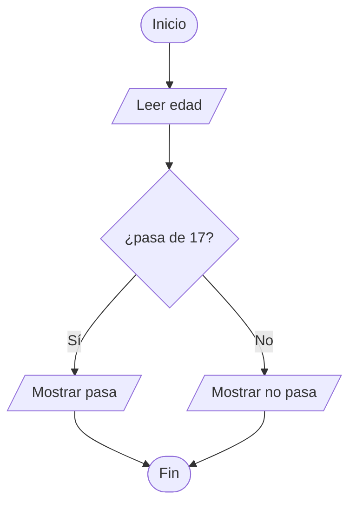
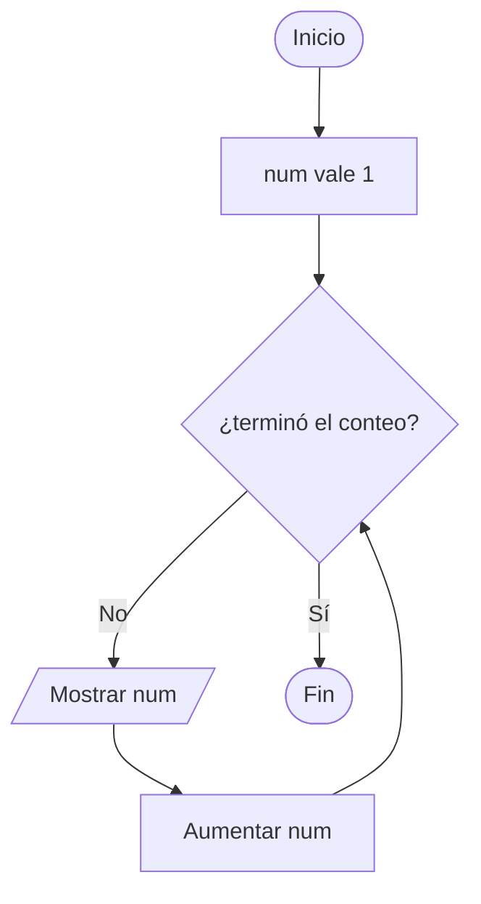

# Módulo 1 - Lógica y algoritmos

> Aquí no se programa todavía. Se aprende a pensar como programa: pasos claros, sin adivinanzas. Todo se escribe primero a mano en español estructurado y al final se comprueba en PSeInt.

## Cómo usar este módulo

Todo el módulo usa 3 técnicas probadas para aprender. Son medibles: siempre sabrás tu puntaje.

1. **Predice antes de ver.** Cada sección abre con un reto que intentas por escrito antes de leer la teoría. Vale 1 punto por intentarlo, aunque falles.
2. **Recuerda sin mirar.** Cada sección cierra con demostración: tapar y hacerlo. Vale 2 puntos si sale completo.
3. **Repite espaciado.** Vuelve en 1, 3 y 7 días solo a lo que fallaste.

Anota todo en [NOTAS.md](./NOTAS.md): tus intentos, tus errores, tus correcciones y tus pruebas. Sin notas no hay puntos.

> [!TIP]
> Regla de avance: no pases al Módulo 2 hasta sacar 8 de 10 en el repaso final (punto 1.6). PSeInt es solo la calculadora que comprueba tus pasos: pensar ocurre a mano.

## Índice

- [Cómo usar este módulo](#cómo-usar-este-módulo)
- [1.1 Qué es un algoritmo](#11-qué-es-un-algoritmo)
- [1.2 Español estructurado a mano](#12-español-estructurado-a-mano)
- [1.3 Diagramas de flujo](#13-diagramas-de-flujo)
- [1.4 Pseudocódigo y PSeInt](#14-pseudocódigo-y-pseint)
- [1.5 Palabras que verás mucho](#15-palabras-que-verás-mucho)
- [1.6 Dudas comunes](#16-dudas-comunes)
- [1.7 Repaso final medible](#17-repaso-final-medible)
- [Para profundizar](#para-profundizar)

## 1.1 Qué es un algoritmo

### Reto rápido

Sin leer más abajo: escribe en 4 líneas cómo freír un huevo, con medidas y tiempos. Guárdalo en `NOTAS.md`. En 2 minutos lo compararás con la teoría.

Un algoritmo es una lista ordenada de pasos que resuelve algo. Cocinar, cruzar la calle y sumar un mercado son algoritmos que ya usas sin darte cuenta.

Un buen algoritmo cumple 3 cualidades:

- **Tiene fin:** termina, no sigue para siempre.
- **Es preciso:** cada paso se entiende sin adivinar. "Echa un poco de sal" no sirve; "echa una cucharada" sí.
- **Da lo mismo con los mismos datos:** si repites los pasos con la misma entrada, sale el mismo resultado.

### Casos borde

Tu receta del huevo probablemente dice "cocina hasta que esté listo". ¿Cómo sabe la compu cuándo está listo? No lo sabe: las máquinas no adivinan. Todo lo ambiguo hay que convertirlo en regla medible ("cocina 3 minutos por lado") o en validación ("si el huevo está frío al tacto, sigue cocinando"). Esta idea, **validar en vez de suponer**, es la base de la lógica real.

### Correcto contra incorrecto

- ✅ Bien: "hierve 500 ml de agua, echa 2 cucharadas de café, espera 4 minutos".
- ❌ Mal: "haz café". Funciona entre humanos que adivinan, no sirve para una máquina.

### Ojo con esto

Creer que la compu "entiende la intención". No entiende nada: solo sigue pasos. Si tu algoritmo necesita que alguien adivine, el hueco está en el algoritmo.

### Investiga

Elige una tarea de tu día (tender la cama, calentar comida, pagar un pasaje), cuenta sus pasos y anota en `NOTAS.md` cuáles son ambiguos. Reescribe esos pasos hasta que otra persona pueda seguirlos sin preguntar.

### Para pensar

1. ¿Qué paso de tu receta del huevo del reto inicial era ambiguo y cómo lo arreglarías ahora?
2. ¿Por qué "cocina hasta que esté listo" funciona con tu abuela pero no con una compu?

### En una frase

Un algoritmo son pasos ordenados, finitos y precisos que dan el mismo resultado con los mismos datos, sin que nadie tenga que adivinar.

### Mide tu avance

Reto intentado por escrito antes de leer (1 punto). Luego tapa la lista y explica qué es un algoritmo más sus 3 cualidades con un ejemplo (2 puntos). Total 3 puntos.

## 1.2 Español estructurado a mano

### Reto rápido

Sin leer la plantilla: suma estos precios hasta pasar de 1.000 (400, 350, 500) y anota en `NOTAS.md` el método que seguiste mentalmente. Luego compáralo con lo de abajo.

Antes de cualquier herramienta, el algoritmo se escribe a mano con esta plantilla:

```text
ENTRADA: qué datos necesito
PROCESO: pasos en orden
SALIDA: qué resultado entrego
```

### Las 4 piezas

Solo necesitas 4 piezas para todo el módulo:

- **Hacer:** una acción. Ejemplo: hervir el agua.
- **Guardar:** meter un dato en una cajita. Ejemplo: total vale 0.
- **Decidir:** elegir un camino. Ejemplo: si llueve, lleva paraguas; si no, no lo lleves.
- **Repetir:** hacer algo varias veces. Ejemplo: mientras queden platos sucios, lava uno.

### Ejemplo completo

Promedio de 3 notas, con validación incluida:

```text
ENTRADA: nota1, nota2, nota3
PROCESO:
  1. Si alguna nota está fuera de 0 a 100, avisar "nota inválida" y terminar
  2. Sumar las 3 notas y guardar en suma
  3. Dividir suma entre 3 y guardar en promedio
  4. Si promedio es 60 o más, decir "aprobado"; si no, decir "reprobado"
SALIDA: promedio y el mensaje
```

El paso 1 es la validación: desconfía de los datos antes de calcular con ellos.

### Tus 3 algoritmos (a mano, sin compu)

1. Preparar café para 2 personas con medidas exactas.
2. Decidir si sales con paraguas según el cielo y el pronóstico.
3. Sumar precios del mercado uno por uno hasta pasar de 1.000, y avisar con cuánto te pasaste.

### Casos borde

Para cada algoritmo, responde un "¿qué pasaría si...?" y agrégale la validación:

1. Café: ¿piden 0 tazas? No hacer nada y avisar. ¿No hay agua? Detenerse con mensaje.
2. Paraguas: ¿el pronóstico dice "tal vez"? Regla por defecto: ante la duda, llevarlo.
3. Mercado: ¿precio negativo? Ignorarlo y avisar. ¿el primer producto ya pasa de 1.000? Avisar igual. ¿escriben texto en vez de número? Pedirlo de nuevo.

### Correcto contra incorrecto

- ✅ Bien: pasos con medidas y validación ("si el precio es menor que 0, avisar e ignorarlo").
- ❌ Mal: pasos que suponen datos perfectos ("sumar los precios" sin decir qué hacer con un negativo).

### Ojo con esto

Probar solo con datos bonitos. Si tu algoritmo solo funciona cuando todo sale bien, no está terminado: pruébalo con ceros, negativos y absurdos.

### Investiga

Escribe los 3 algoritmos en `NOTAS.md` con su plantilla y su validación. Haz la prueba de escritorio de al menos uno: una tablita donde sigues tus pasos con un ejemplo real (incluido un caso borde) y anotas qué vale cada dato en cada paso.

### Para pensar

1. ¿En qué se parece validar un precio negativo a revisar que el huevo no esté frío?
2. ¿Por qué un algoritmo con validación es más largo pero más confiable que uno sin ella?

### En una frase

Escribir a mano con entrada, proceso y salida te obliga a decidir cada paso y cada validación antes de tocar cualquier herramienta.

### Mide tu avance

Reto del mercado intentado antes de leer (1 punto). Luego escribe los 3 algoritmos con validación y prueba de escritorio sin mirar (2 puntos). Total 3 puntos.

## 1.3 Diagramas de flujo

### Reto rápido

Sin ver los símbolos: dibuja con cajitas y flechas cómo decides salir con paraguas. Guárdalo en `NOTAS.md` y compáralo con la simbología real.

Un diagrama es el mismo algoritmo dibujado. Solo usa 5 figuras:

| Figura | Significa | Ejemplo |
| --- | --- | --- |
| Óvalo | Inicio o fin | Inicio |
| Paralelogramo | Leer o mostrar | Leer edad |
| Rectángulo | Hacer algo | Total vale total más precio |
| Rombo | Decidir | ¿Pasa de 17? |
| Flecha | Orden de los pasos | Va del paso 1 al 2 |

### Diagrama con decisión

Permiso para entrar:



En palabras: lee la edad; si pasa de 17 muestra "pasa", si no muestra "no pasa".

Todo rombo necesita sus dos salidas con destino. Un camino sin flecha es un camino muerto: un caso que no contemplaste.

### Diagrama con repetición

Contar del 1 al 5:



En palabras: empieza en 1, muestra el número y súbelo hasta terminar el conteo.

Dos ideas profesionales en un dibujo: si el paso E no existiera, C siempre diría lo mismo y tendrías un **bucle infinito**. Si un caso no tiene flecha de salida, tienes un **camino muerto**. Los diagramas sirven para cazar estos dos errores de un vistazo.

### Casos borde

Edad de -5 o 250: añade un rombo de validación antes (¿edad entre 0 y 120?) con salida de error. Contar hasta 5 empezando en 10: el bucle termina sin mostrar nada, ¿es eso correcto o un error silencioso? Anota tu respuesta.

### Correcto contra incorrecto

- ✅ Bien: rombo con Sí y No, cada uno llegando a algún lado.
- ❌ Mal: rombo con una sola salida, o bucle cuya condición nunca cambia.

### Ojo con esto

Dibujar el camino feliz y olvidar los bordes. Recorre siempre cada rombo por los dos lados antes de darlo por bueno.

### Investiga

Dibuja tus 2 diagramas en `NOTAS.md` (a mano o en Mermaid): permiso para entrar con validación de rango, y suma del mercado hasta pasar de 1.000. Recorre cada uno con 2 casos distintos y anota qué sale en cada caso.

### Para pensar

1. ¿Cómo distingues en el dibujo un bucle infinito de uno que termina?
2. ¿Por qué un camino muerto es peor que un error visible?

### En una frase

El diagrama muestra de un vistazo lo que el texto esconde: cada decisión necesita sus dos caminos y cada repetición necesita su salida.

### Mide tu avance

Reto del paraguas dibujado antes de ver símbolos (1 punto). Luego dibuja los 2 diagramas con recorridos de 4 casos anotados, sin mirar (2 puntos). Total 3 puntos.

## 1.4 Pseudocódigo y PSeInt

### Reto rápido

Sin leer la sintaxis: ¿cómo le ordenarías a alguien guardar el número 5 en una cajita llamada total, sin usar la palabra "guardar"? Anota tu invento en `NOTAS.md`. La respuesta profesional existe y se llama asignación.

El pseudocódigo es el algoritmo en español casi de programador. PSeInt solo lo ejecuta para comprobarte. Pero la sintaxis tiene lógica, no es capricho:

- **`<-` significa "guarda en".** `total <- 0` se lee "total guarda 0". Es una acción.
- **`=` significa "¿son iguales?".** Se usa para comparar, como en `Si edad = 18`. Es una pregunta.
- Confundirlos es el error clásico: uno guarda, el otro compara.

La **sangría** (espacios a la izquierda) muestra qué pasos están dentro del `Si` o del `Mientras`. En PSeInt ordena la vista; en Python será obligatoria. Acostúmbrate desde hoy: lo de adentro siempre va más a la derecha.

```text
Escribir "texto"     // mostrar en pantalla
Leer dato            // pedir un dato
total <- 0           // guardar un valor (acción)
Si edad = 18 Entonces // comparar (pregunta)
  pasos de adentro
SiNo
  otros pasos
FinSi
Mientras quedan Hacer
  pasos de adentro
FinMientras
Para i <- 1 Hasta 5 Hacer
  pasos de adentro
FinPara
```

El ejemplo del promedio, ahora en pseudocódigo:

```text
Escribir "Dime las 3 notas"
Leer nota1, nota2, nota3
Si nota1 < 0 O nota1 > 100 Entonces
  Escribir "Nota inválida"
SiNo
  suma <- nota1 + nota2 + nota3
  promedio <- suma / 3
  Si promedio >= 60 Entonces
    Escribir "Aprobado con ", promedio
  SiNo
    Escribir "Reprobado con ", promedio
  FinSi
FinSi
```

Cómo comprobar en PSeInt: escríbelo, ejecútalo paso a paso y compara con tu prueba de escritorio a mano. Si difieren, primero sospecha del algoritmo, no de la herramienta. Prueba siempre con un dato normal y uno inválido (nota 150): el inválido debe activar tu validación, no romper el programa.

### Instalar PSeInt

Hazlo una sola vez antes de seguir, con calma:

1. Descarga el instalador para tu sistema (Windows, macOS o GNU/Linux) desde la [página oficial de PSeInt](https://pseint.sourceforge.io/).
2. Instálalo como cualquier programa y ábrelo.
3. Elige el perfil Flexible cuando te lo pregunte: acepta varias formas de escribir y no te peleará por la sintaxis.

Si te trabas instalando, anota el error exacto en `NOTAS.md`: ese mensaje es tu primera lectura de errores reales.

La validación final: dale tu pseudocódigo a otra persona (o léelo en voz alta actuando como la compu) sin explicar nada extra. Si se traba, el hueco está en el algoritmo.

### Casos borde

Nota 150 o -20: debe mostrar "Nota inválida", nunca un promedio absurdo. Texto donde va número: PSeInt se queja; anota qué mensaje muestra y qué significa con tus palabras.

### Correcto contra incorrecto

- ✅ Bien: `total <- total + precio` para acumular, con nombres que se entienden.
- ❌ Mal: `x = x + p` para lo mismo. Funciona igual, pero nadie (ni tú en una semana) sabe qué guarda `x`.

### Ojo con esto

Usar `=` para guardar. En pseudocódigo `=` compara: si lo usas para asignar, tu programa decide en vez de guardar, y falla en silencio.

### Investiga

Pasa uno de tus 3 algoritmos a pseudocódigo en `NOTAS.md` con nombres descriptivos y sangría. Ejecútalo en PSeInt con 2 datos (uno normal, uno inválido) y anota ambas salidas. Valida el otro con lectura en voz alta y anota dónde te trabaste, si pasó.

### Para pensar

1. ¿Por qué los lenguajes separan guardar (`<-`) de comparar (`=`)? ¿Qué pasaría si fueran lo mismo?
2. Si la sangría ya ordena el código en PSeInt, ¿por qué Python la vuelve obligatoria?

### En una frase

El pseudocódigo traduce tus pasos a mano a reglas estrictas: guardar con `<-`, comparar con `=`, validar entradas y marcar con sangría lo que va adentro.

### Mide tu avance

Reto de la cajita intentado antes de leer (1 punto). Luego escribe el pseudocódigo con validación y sangría, más 2 casos corridos y anotados, sin mirar (2 puntos). Total 3 puntos.

## 1.5 Palabras que verás mucho

- **Algoritmo:** pasos ordenados que resuelven algo. Ejemplo: la receta del café.
- **Entrada:** datos que recibe. Ejemplo: las 3 notas.
- **Salida:** resultado que entrega. Ejemplo: el promedio.
- **Variable:** cajita con nombre para un dato que cambia. Ejemplo: `total`.
- **Condición:** pregunta que se responde sí o no. Ejemplo: ¿pasa de 17?
- **Bucle:** repetición hasta que algo se cumpla. Ejemplo: mientras queden platos, lava.
- **Pseudocódigo:** algoritmo en español casi de programador. Ejemplo: la sección 1.4.
- **Validación:** revisar los datos antes de usarlos. Ejemplo: nota entre 0 y 100.
- **Caso borde:** dato raro pero posible que rompe lo no previsto. Ejemplo: precio negativo.

> [!TIP]
> Mide tu avance (4 min): predice por escrito cuáles 2 términos te costarán más (1 punto). Luego tapa y define los 9 en voz alta con ejemplo: 8 a 9 bien valen 2 puntos, 6 a 7 valen 1 punto, menos es 0. Anota tu puntaje en `NOTAS.md`.

## 1.6 Dudas comunes

**¿PSeInt es programar?**
No. Es una calculadora de algoritmos: comprueba tu lógica, pero lo que aprende tu cerebro ocurre a mano.

**¿Por qué escribir a mano primero?**
Porque la herramienta no piensa por ti. Si el algoritmo está mal a mano, en PSeInt estará igual de mal pero más rápido.

**¿`< -` y `=` no hacen lo mismo?**
No. `<-` guarda (acción), `=` compara (pregunta). Mezclarlos es el error silencioso más común.

**¿Cómo noto un bucle infinito?**
Si la condición del rombo nunca puede cambiar porque ningún paso la toca, el programa no sale jamás. En PSeInt se queda corriendo: ese es el síntoma.

**¿Validar no es exagerar para un principiante?**
No, es el hábito que separa un juguete de un programa real. Empieza con una validación por algoritmo.

**¿La sangría afecta o es decoración?**
En PSeInt ordena; en Python decide. Úsala siempre como si decidiera.

## 1.7 Repaso final medible

Hazlo sin mirar el resto del módulo. Suma tus puntos al final. Todo queda anotado en `NOTAS.md`.

### Práctica 1 - Los 3 algoritmos a mano (2 puntos)

Entrega los 3 algoritmos de la sección 1.2 con plantilla ENTRADA/PROCESO/SALIDA y al menos una validación cada uno (1 punto), más la prueba de escritorio de uno con ejemplo real y un caso borde anotados (1 punto).

### Práctica 2 - Los 2 diagramas recorridos (2 puntos)

Entrega los 2 diagramas de la sección 1.3, uno con validación de rango (1 punto), más los recorridos con casos normales y borde anotados (1 punto).

### Práctica 3 - Pseudocódigo que corre y se entiende (2 puntos)

Pseudocódigo ejecutado en PSeInt con un caso normal y uno inválido anotados (1 punto), más validación en voz alta o con otra persona sin trabas, o con trabas corregidas y anotadas (1 punto).

### Auto-test de vocabulario (4 puntos)

Sin mirar el punto 1.5, define los 9 términos con un ejemplo cada uno. De 8 a 9 bien son 4 puntos, de 6 a 7 son 2 puntos, menos es 0.

### Tu puntaje y qué hacer

| Puntaje | Significa | Qué hacer |
| --- | --- | --- |
| 8 a 10 | Listo | Pasa al Módulo 2 |
| 5 a 7 | Casi | Repite mañana solo las prácticas falladas |
| 0 a 4 | Relee | Relee el módulo pasado mañana y repite el repaso |

### Plan de repaso espaciado

- [ ] Día 1: repaso final completo y puntaje anotado en `NOTAS.md`.
- [ ] Día 3: solo recuerdo sin mirar de lo que fallaste.
- [ ] Día 7: repite las 3 prácticas en 30 minutos.

## Para profundizar

- [Descargar PSeInt y su documentación](https://pseint.sourceforge.io/): herramienta oficial con manual y ejemplos de pseudocódigo.
- [Guía de PSeInt del Gobierno de Canarias](https://www3.gobiernodecanarias.org/medusa/ecoescuela/recursoseducativos/): tutorial paso a paso en español para primeros algoritmos.
- [CS Unplugged: algoritmos](https://csunplugged.org/es/topics/algorithms/): actividades sin compu para pensar como programa.

## Siguiente paso

Pasa al Módulo 2 cuando tu puntaje sea de 8 o más, donde estos mismos pasos se escribirán en Python.
