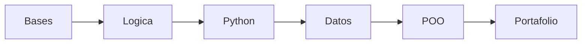

# Aprender Programación

> De cero a programador con proyectos reales, método medible y Python como primer lenguaje.

## La ruta de un vistazo

| Módulo | Semanas | Carpeta | Salida que lo valida |
| --- | --- | --- | --- |
| 0 - Bases | 1 | `00-bases-computacion/` | Repaso final con 8 de 10 |
| 1 - Lógica | 2 | `01-logica/` | 3 algoritmos más 2 diagramas |
| 2 - Python y Git | 3 | Por crear | 6 ejercicios con commits limpios |
| 3 - Datos y archivos | 3 | Por crear | Agenda en `JSON` que no se cae |
| 4 - POO | 2 | Por crear | Proyecto integrador con `README` |
| 5 - Portafolio | 1 | Por crear | Proyecto publicado en GitHub |

> [!IMPORTANT]
> Ningún módulo se da por terminado sin su proyecto funcionando más el repaso en 8 o más. El detalle del plan está en [RUTA.md](./RUTA.md).

## Cómo se estudia aquí

1. Recuerda sin mirar lo de ayer (20 min).
2. Construye el proyecto del día (80 min).
3. Anota y marca tu avance (20 min).

Cada módulo usa fricción antes que teoría, recuerdo activo y repaso espaciado día 1/3/7. El plan completo está en [RUTA.md](./RUTA.md).

## Módulo actual

Llevas M0 y M1 listos. Empieza en [Módulo 0 - Bases de la Computación](./00-bases-computacion/README.md) y sigue con [Módulo 1 - Lógica y algoritmos](./01-logica/README.md). Cada uno trae su diario (`NOTAS.md`).

> [!TIP]
> Sigue tu avance en [CHECKLIST.md](./CHECKLIST.md). Marca solo lo que ya puedas explicar sin mirar.

## Ejercicios de Python

| Ejercicio | Habilidad que valida |
| --- | --- |
| Calculadora de presupuesto | Variables, `input` y aritmética |
| Conversor de divisas | Casting y constantes |
| Validador de acceso | Condicionales y `and`/`or`/`not` |
| Impuestos progresivos | Cadenas de `elif` |
| Inventario con `while` | Bucles y control de stock |
| Reporte de ventas | `for` con `range()` y acumuladores |

Un script por ejercicio en `python/`, por ejemplo `python/ejercicio_2_1.py`.
